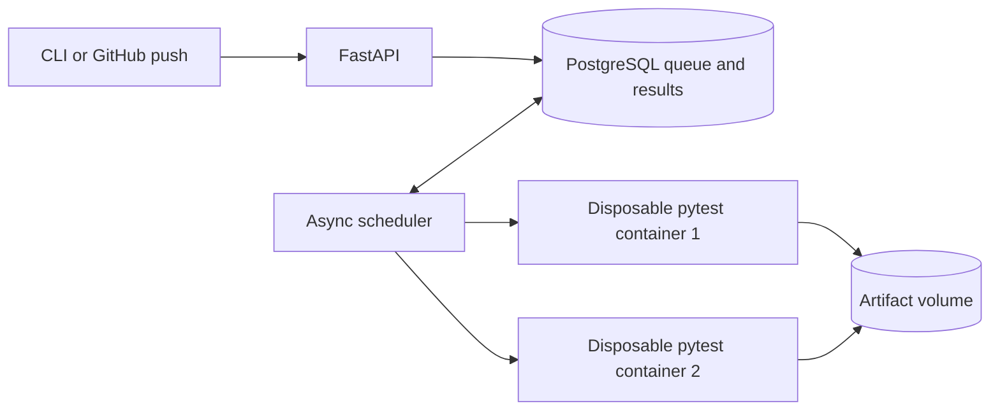

# ReproCI

ReproCI is a small CI engine for trusted Python repositories. Ordinary CI tells you
that a test failed; ReproCI keeps the exact commit, test image, test ID, and attempt
history so you can rerun one failure and find the first commit that broke it.



**What to look at:** `api.py` validates and queues requests; `scheduler.py` claims
jobs and supervises two slots; `runner.py` makes a clean checkout and restricted
container; `pytest_plugin.py` records exact node IDs and phase outcomes. Every
debugging attempt is linked to the original attempt in PostgreSQL.

## Run the local demo

Prerequisites: Docker Desktop or Linux Docker Engine with Compose, Python 3.11+,
and `uv`. Docker must support volume subpaths (Engine 26+). The demo uses a local
generated Git history, so no GitHub account is needed for the core loop.

```bash
python3 demo/create_history.py demo/history
docker build -t reproci-demo-test:local demo
docker compose up --build -d
uv sync --locked
```

The API binds to `127.0.0.1:8001` by default. Set `REPROCI_PORT=18743` before
`docker compose up` if that port is occupied, and set
`REPROCI_API_URL=http://127.0.0.1:18743` for CLI commands. The API docs are at
`http://127.0.0.1:8001/docs`.

In another terminal, get the image ID and demo SHAs:

```bash
docker image inspect reproci-demo-test:local --format '{{.Id}}'
git -C demo/history rev-parse HEAD HEAD~4 HEAD~3
```

Use the returned image ID, `HEAD` as the bad commit, `HEAD~4` as good, and
`HEAD~3` as the expected first bad commit:

```bash
uv run reproci repo add demo --url file:///demo-history --image-id <image-id>
uv run reproci run demo --commit <bad-sha>
uv run reproci status <run-id>
uv run reproci tests <run-id>
uv run reproci replay <attempt-id> --test tests/test_total.py::test_total
uv run reproci flakes <attempt-id> --test tests/test_flaky.py::test_synthetic_flaky --repeats 10
uv run reproci bisect <attempt-id> --good <good-sha> --bad <bad-sha> --test tests/test_total.py::test_total
uv run reproci job <job-id>
uv run reproci retry <failed-or-error-job-id>
uv run reproci report <run-id> --output report.md
```

`run`, `replay`, `flakes`, and `bisect` queue work and return immediately. Poll
`status` or `job` for completion. The failing `test_total` replay should fail
again, and bisect should report `HEAD~3`. The random-draw flaky fixture is
synthetic; ten attempts often show mixed outcomes but are not guaranteed to.
`retry` creates a new job and attempt, preserving the original result.
For a retained attempt log, use
`docker compose exec scheduler cat /artifacts/attempts/<attempt-id>/stdout.log`.

To demonstrate two slots, submit three runs rapidly and inspect their job IDs.
The first two should overlap while the third waits. To reproduce the throughput
measurement, register another repository named `bench` at the same demo URL
with `pytest_args` set to
`["tests/test_work.py::test_independent_two_second_work"]` through `/docs`, then run
`uv run python scripts/benchmark.py --repository bench --commit <good-sha>`.
It restarts only the scheduler between modes and measures from batch submission
until all eight jobs finish. See
[benchmark results](examples/benchmark.json), [raw data](examples/benchmark.csv),
and [overlapping job timestamps](examples/concurrency.json).

```bash
docker compose down
```

This preserves PostgreSQL and artifacts. To delete them, explicitly run
`docker compose down -v`.

## Webhook demonstration

Set `REPROCI_GITHUB_SECRET` before starting Compose. Register a public demo
repository with its exact HTTPS clone URL, fixed test image ID, and allowed
branch. Configure a GitHub push webhook pointing **only** to
`POST /webhooks/github` through a temporary tunnel or reverse proxy. The API
verifies `X-Hub-Signature-256` over raw bytes, records GitHub's delivery ID,
and queues one run. Redelivery returns the existing run ID. A real delivery
requires a public repository and an authenticated GitHub account; the local
fixture exercises the same endpoint with signed synthetic payloads.

## Evidence and limits

- [Architecture and state model](docs/architecture.md)
- [Walkthrough and expected results](docs/demo.md)
- [Validation record](docs/validation.md)
- [Example run report](examples/report.md)
- [Plan and acceptance checks](plan.md)

Only explicitly registered, trusted Python repositories are supported. Docker
reduces accidental interference but is not a security boundary for hostile code.
Replay keeps the original image and commit but can remove test-order effects.
Mixed valid pass/fail outcomes at fixed inputs establish *observed* flakiness;
all passes do not prove stability. Bisect assumes a linear, monotonic regression
and reports the first observed test-breaking commit, not the faulty line.
